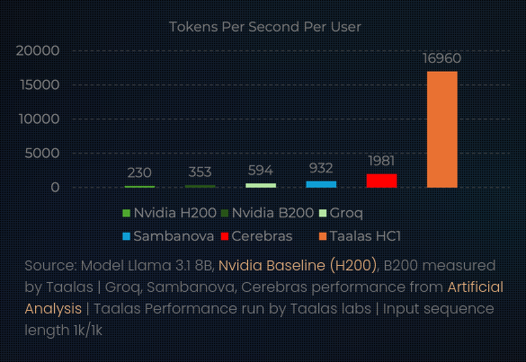

# Introduction

Taalas (https://taalas.com/) launched their HC1 chip on February 19th, 2026. Their goal: create an accelerator designed to produce the highest amount of tokens per second by targeting specific LLM transformers (in the case of the HC1, Llama 3.1 8B). Built on TSMC's 6nm process node, its die size was about 815mm^2 (near reticle limit), with about 53 billion transistors.

The really interesting thing about this chip that excites me is the fact that Taalas claims to be able to serve about 16,960 tok/sec to a given user (https://taalas.com/products/). For context (as shown below), Taalas' own study reports that an NVIDIA H200 delivers only 230 tok/sec, with Cerebras reaching a mere 1981 tok/sec (about 8.6x worse than Taalas).

The obvious downside of this is that they achieve this remarkable throughput by hardcoding the model into the silicon, meaning that they can only run Llama 3.1 8B on their HC1 (there is some nuance to this, but for now that is the high level claim). One thing I want to flag right at the top, because it changed how I read everything else. When you first hear about this chip, it's easy to imagine one giant block of exotic, maximally-dense, noisy memory. The HC1 that shipped is way more boring than that. The weights sit in plain exact mask ROM, and the working state sits in regular SRAM. A lot of the scarier-sounding patents (the multibit cells, the denoising networks, the noise-cancelling fine-tuning) I think are really a roadmap for some denser future chip, not a description of the HC1 as built, and I'll try to keep that line clear throughout.

Now I am extremely interested in how they achieved this, and whether there is any takeaway from their methodology. I tried out their chatbot (https://chatjimmy.ai/), and the response time is basically instant (sometimes I couldn't even tell it responded because it came back so fast it didn't clock to me).

# Exploration

My first instinct to understand their architecture was to look at Taalas' patents and some of the patents from their founders. A list of the patents I looked at is as follows:

- Large Parameter Set Computation Accelerator Using Configurable Connectivity Mesh (US 2025/0123802) (Patent 1)
- Large Parameter Set Computation Accelerator Using Memory With Parameter Encoding (US 2025/0225198) (Patent 2)
- Hardware Implemented Codebook Pointers (US 2026/0023566) (Patent 3)
- Multibit High Density Read Only Memory Using Multiple Reference Biases (US 2025/0029669) (Patent 4)
- Mask Programmable ROM Using Shared Connections (US 2026/0150278) (Patent 5)
- Computing Architecture With Model Core and Fine-Tuning Portion (US 2025/0238726) (Patent 6)
- Integrated Circuit With Fine Tuning Model Parameters for Noisy Memory Cancellation (US 2026/0057301) (Patent 7)
- Integrated Denoising Neural Network for High Density Memory (US 2025/0028935) (Patent 8)
- Integrated Random Access Memory Using Inverter Loops (US 2025/0029671) (Patent 9)

There are MANY more patents filed under Ljubisa Bajic, Lejla Bajic, and Drago Ignjatovic (CEO, COO, and CTO respectively), but these are the ones I found to be the most related to Taalas and filed during the time Taalas was actively developing their HC1. We can break these patents up into four sections: Core computation/multiplication, ROM cell design, LLM fine-tuning circuit support, and dense memory. I will do my best to give my thoughts and takeaways from these patents, but I also highly recommend reading them yourself (and talking to me about them)!

## Core Computation/Multiplication

The patents I explored for the core computation and multiplication were Patents 1 through 3.

Patent 1's goal is to discuss "computational architectures for accelerating vector multiplications", specifically matrix multiplication. The key insight that underlies this patent is that as LLM parameters scale to the billions and trillions, the number of available values for a given parameter is limited. For example, a 4-bit quantized data type can only have 16 possible values, and an 8-bit quantized value can only have 256 different values. With more and more models utilizing aggressive quantization strategies like these, Taalas aims to exploit this pattern by basically having dedicated multipliers for each potential type of multiplication (i.e. mult x, 0; mult x, 1; mult x, 2; ...; mult x, 15), multiplying a given quantized value by every single potential value it could be multiplied by, and using a "set of readable cells" (i.e. ROM) to choose which multiplication value to use.

This is a lot of information, but a more digestible way of thinking about it is like this: each parameter of a transformer (ignoring fine-tuning for now) is a fixed value (let's call this value x). If x is a quantized value of 4 bits, there are only 16 possible values it can hold. More importantly, there are only 16 possible multiplication values that can come out of multiplying x by another 4-bit value. If we do all 16 multiplications in parallel while pulling a selector value for the parameter out of ROM, we can speed up the time it takes to do a multiply.

This is one of the big points established by this patent, but it's not completely clear why this is important. With a traditional multiplication, you need to pull your two values in from memory (either SRAM or HBM), send them through a general-purpose multiplier (which, to be performant across multiple values, must be larger and typically takes multiple cycles), and then store the value back into memory. With this setup, Taalas can pull a value in from SRAM, compute all possible values it can produce in parallel with dedicated multipliers (one for 0, one for 1, ..., one for 15), and then, in parallel with this computation, have ROM select which multiplier output it wants to store in memory once done. This means the path an operation must travel is from SRAM to a highly optimized multiplier and then finally back into memory, which is extremely efficient.

This sequence of operations dictates one multiplication, and so Taalas achieves matrix/vector multiplication by accumulating these individual multiplication values over the course of multiple cycles and multiple weight-multiplier selections. One weight matrix can be represented as multiple rows of ROM (again, what the patent refers to as readable cells). The way each of those readable cells gets tied to the one multiplier that matches its weight value is through what Taalas refers to as their "configurable connectivity mesh", which the patent describes as a mesh of wires and vias in the metal layers that gets configured using back-end-of-line masks. The thing to realize is that this means the selection is baked right into the metal; the wiring that routes a given multiplier's output to all the cells that share that weight value is physically patterned into the top-level interconnect at tape-out, not decided at runtime. The cell sitting on the other end of that wiring "can consist essentially of a single access transistor", and its gate is driven by a word line, so when you activate the word line for a row, every access transistor in that row turns on and dumps the pre-wired multiplier output it's connected to onto its read line. The read circuit then pulls that whole row of products out in parallel and hands them to the accumulator. So the "which multiplier does this weight pick" decision isn't a selector value that gets read out and decoded every cycle; it's hardwired into the mesh, and the only thing reading a row of ROM actually does is choose which set of already-wired products to drop onto the read lines and accumulate.

Now this is where Patent 2 comes in, because that hardwired mesh is the simplest way to picture the selection, but it isn't free. If you think about it, physically routing a connection from every multiplier output to every readable cell that happens to share that value means the mesh has to carry a dedicated wire for each of those pairings, and once you scale that out across every parameter in a matrix the interconnect needed to route all of those possible connections becomes massive. Patent 2 is basically the exact same core idea (precompute all 16 products, then pick the right one per weight), but it swaps out how the selection happens with a denser solution. Instead of hardwiring the choice into the mesh, the readable cell now stores an address (the patent calls it "a set of addresses that is associated with the set of values of the set of parameters"), the read circuit reads that address out, and the address is what drives a selector/multiplexer to pick which multiplier output gets passed through. I should be clear that this "Patent 1 is a mesh, Patent 2 is an address plus a mux" split is really just my own way of contrasting the two; Taalas never frames them as alternatives, and Patent 2 itself covers both (its independent claims are the address-and-mux scheme, but it also has its own connectivity-mesh claims).

With the hardwired mesh, the cost of selecting scales with the number of possible connections you're physically routing, which is what blows up the interconnect area. With the address-into-a-mux approach, you only need enough ROM bits to encode the address (one of 16 outputs is just a 4-bit address per parameter), and the selector hardware stays basically the same size no matter how big the block of ROM gets. So you're taking what was a big spread-out mesh of interconnect and compressing it down to a compact address decode, and since the patent points out each of those readable cells can be a single access transistor plus a storage element, you can make the number of stored parameters really large at minimal cost. It's the same multiplication trick from Patent 1, just with way less silicon spent on the act of actually choosing the answer.

The benefit of both of these patent implementations is that they allow Taalas to reconfigure their chip to serve other models at tape-out time. Instead of hardcoding the weights into ROM, Taalas hardcodes the selection of the multiplier values in ROM. This translates a multiply of a non-weight value with a weight value into a multiply of a non-weight value with all 16 multipliers, and lets the ROM select which one we want. If we have the ability to change which multiplier value we want, we then effectively change the weights that we multiply by without ever changing the underlying SRAM/multiplier hardware, only the ROM with the selection. So to run another model on Taalas' HC1 chip, they would just need to replace their mask ROM with the new selector values.

Patent 3 (Hardware Implemented Codebook Pointers) takes the "store the selection, not the weight" idea and applies to to the traditional pointer paradigm most programmers know. The idea is called a codebook; you keep a small set of registers that hold the distinct values a parameter can actually take (the patent's example uses 16 registers holding the values 0 through 15), and then every parameter in the model gets one readable cell that doesn't store a value at all, just a compact index into that register file. You read a cell, you get an address, the address drives a mux (or, in the other version, a connectivity mesh that physically wires the cell straight to a register), and out comes the actual value. So the readable cells are the indices (keys) to the registers that contain the relevant value for a parameter, which is very similar to the concept of a dictionary or map.

Why does this matter for Taalas? First, since so many parameters end up sharing the same handful of distinct values, you can change *every* parameter that points at a given value by editing a single register, which is where the patent's "4,000 operations become 16" example comes from. Second, and this is the part I think is really cool, the pointers stay put while the values they point at are free to change underneath them. The patent points out you can re-quantize, bump the bit-width from 4-bit to 16-bit, or even swap the data type just by rewriting the registers, "without changing an addressing scheme or a connectivity infrastructure". So the expensive, dense, hardwired part of the chip (that giant array of pointers baked into the metal) never has to move, and all the flexibility lives in a tiny register file. One thing to note is that this patent never really describes the multiplier array we mentioned in the previous patents, it just says the selected values get sent off to "computation logic" that "may include matrix multiplication accelerators". So the link back to the precompute-all-16-products scheme from Patents 1 and 2 is that the this codebook could be used to store/change the fixed values each multiplier multiplies by, and then the connectivity mesh/selector can be used along with the address to select the multiplier output. All together, we now achieve parallel and efficient multiplication for all quantized values with parallel selection. If we want to change the quantization, we can do see through the codebook to allow for smaller or larger quantized values. 

These three patents for the core architecture, but they obviously has some bottlenecks, as we can only store as many weight selectors as there is ROM to hold them (Llama 3.1 8B is tiny compared to the gigantic models we have nowadays). Additionally, this requires 16 multipliers to perform one operation, which is still a high area overhead for a single operation. Let's say you want to do more than one multiplication at a time now; you need 16 * [number of concurrent multiplication operations] Current staff  to actually do all of this. Granted, there only needs to be K multipliers, where K is the max quantization we want to support. A larger issue someone might think to ask is how Taalas is able to perform such a high number of operations per second, and this is really where the whole ROM vs HBM thing becomes the entire point of the architecture.

The thing to realize is that on a traditional GPU, token generation (the decode phase) isn't actually compute bound, it's memory bandwidth bound. To spit out a single token the hardware has to stream basically every weight in the model out of HBM, across the bus, and into the compute cores, so your throughput ceiling is just the memory bandwidth divided by the number of bytes you read per token. An H200's HBM3e tops out around 4.8 TB/s, and streaming the ~16 GB of Llama 3.1 8B weights (plus the growing KV cache traffic) once per token lands you right in that few hundred tokens per second range.

Now let's run that same math for Taalas' claimed 16,960 tok/sec. If you had to fetch the weights from any kind of bus attached memory, you'd need roughly (weight bytes) x (tokens/sec) of bandwidth; even at an aggressive 4-bit quantization (~4 GB for 8B params) that's about 68 TB/s, and at 8-bit it's ~135 TB/s, which is something like 14 to 28x what an H200's HBM can actually deliver (https://turingpi.com/llm-tokens-per-second-memory-bandwidth/). No amount of HBM stacking realistically gets you there. The only way to satiate that kind of instruction throughput is to just stop moving the weights at all, and that's precisely what the mask ROM selectors does.

To get at why this solves the problem, we need to look at interconnect delay. Interconnect delay is dominated by the RC product of the wire, and the really important part is that this RC delay grows with the *square* of the wire length; global wires that have to span the whole die can end up costing as much delay as the logic itself, to the point where designers chop them up with repeaters just to keep them sane (https://research.cs.wisc.edu/multifacet/theses/bradford_beckmann_phd.pdf). By keeping the selector ROM right up against the multiply-selectors, the wire length between them is tiny, so the RC delay is tiny, and the selector value can be read out and applied every single cycle without the ROM read ever becoming the critical path. Contrast that with an HBM read, where the value has to cross the package, the bus, and the on-chip global interconnect before it ever gets anywhere near a multiplier.

The last piece that ties this all together is that this multiply-select ROM block isn't one big shared structure. By duplicate aforementioned design all over the die, we basically get a local cluster of selector ROM plus its own dedicated multipliers for each weight matrix, and by extension for each layer of the transformer. Because every layer's weights are stationary in their own little patch of silicon, you can perform operations on all the layers concurrently and pipeline them instead of time-sharing one large ROM memory port. This effectively turns what would've been a single ~TB/s HBM channel into the entire die's worth of ROM being read in parallel, and that's really where the aggregate on-chip "bandwidth" needed to hit tens of thousands of tokens per second comes from. The cost, obviously, is area; you need to give every single weight in the model its own ROM slot on the chip.

## ROM Cell Design

Everything above assumes you can actually fit a whole model's worth of selectors into ROM sitting right next to the multipliers, so the next thing to figure out is what that ROM cell physically looks like. Patents 4 and 5 are the two I found that cover this, however, they seem to propose two different ways to making ROM. Patent 5 is an exact, binary cell; Patent 4 trades that exactness for density by cramming multiple bits into a single cell. I'm fairly convinced the HC1 uses the exact one, mostly because the public reporting lines up with that, so for the purposes of higher architecture analysis I'll treat Patent 5 as the HC1's main ROM implementation, and **Patent 4 as a density improvement that isn't needed for the HC1, but that Taalas would use for some denser future chip**.

Patent 5 (Mask Programmable ROM Using Shared Connections) is the closest to a "normal" mask ROM, and it's the one that I think Taalas uses due to being able to swap out the weight selectors easily with a new re-spin. Each cell is just a single standard MOS transistor, the same kind you'd use for logic, which matters because it means the ROM doesn't need any special process steps and can be built right alongside everything else. The transistor uses its source and drain for two different jobs: one terminal (the "read terminal") connects to a read line you sense through, and the other (the "bit terminal") is where the programming happens. You route several bit lines over that bit terminal, and the stored value is just a question of which of those lines is actually connected down to the terminal through a mask-programmable via (a line with a via is connected, a line without one isn't). So the entire contents of the ROM come down to one layer of vias, and you reprogram the whole thing (i.e. load a different model's selectors) with a single mask/vias change. The word lines and bit lines are each shared across two or more transistors instead of every cell getting its own, and to keep all those shared lines from stepping on each other during a read, each via sits behind a little pn-junction diode (a P+ counter-doped contact on the bit terminal) so current only flows for the bit line you're actively driving. You pre-charge the read line, raise one word line, then walk the bit lines one at a time while a sense amp watches the read line; in the patent's example that reads 16 bits over four cycles. The thing to realize here is that this cell is exact. A bit is either wired down through a via or it isn't, so you read back a clean 1 or 0 without needing to worry about true-multi-bit analog storage. 

Patent 4 (Multibit High Density ROM Using Multiple Reference Biases) goes after the same density problem from the other direction, by getting a single transistor to store more than one bit. Instead of a cell being a binary "connected or not", you wire the transistor's terminal to one of several different reference voltages, and the value is encoded in which voltage it's tied to. The simple version connects one node to one of N+1 supply rails and gets you log2(N+1) bits in a single device; the fancier version biases the gate *and* the drain independently, and the conductivity you end up with (basically how much current the transistor carries, which depends on both biases) encodes the value, which gets you up to around log2(N^2) bits per cell. All those reference voltages come from a bank of regulators (LDOs) off a single supply. Squeezing multiple bits into one analog level per transistor can cause noise read-outs (similar to multi-bit PCM), so something like a sense amp has to figure out which of several current levels a cell is sitting at, and process variation or read-back noise can nudge it into the wrong bucket. **Given we know Taalas uses Mask ROM, this Patent is not really applicable to understanding the HC1 architecture, but rather something to look forward to w.r.t denser memory in the HC2.**

**Quick Disclosure** before I continue; Patent 4 was extremely hard for me to understand and comprehend, as I do not come from a strong analog background. While the writing above is my best articulation of how I understood it, please take the time to review the source material yourself (advice I also recommend for every other patent).

## LLM Fine-Tuning Circuit Support

Back in the intro, I said there was "some nuance" to the idea that the HC1 can only ever run the model weights it was loaded with (or as we discovered previously, it's quantization and addressability represents). This isn't quite true, as the chip isn't actually a fully frozen block of ROM. Patents 6 and 7 both describe some split where a hardwired "model core" holding the base model's weights in high-density mask ROM (fixed at fabrication, i.e. all the stuff from the last two sections), plus a much smaller, writable "fine-tuning portion" sitting in some lower-density programmable memory (SRAM, DRAM, flash, whatever). The fine-tuning portion is tiny next to the core with it's ROM and multipliers, and Patent 7 puts it at something like a millionth to a billionth of the base parameter count because it utilizes LoRA to store the required weight modifications in a lower dimensional latent space.

The HC1 pairs the mask ROM with an on-chip SRAM "recall fabric", and per Taalas' own VP of product it's that SRAM that holds the KV cache along with "adapters and customizations" ([DataCenterDynamics](https://www.datacenterdynamics.com/en/news/ai-chip-startup-taalas-raises-169m-unveils-hc1-processor-optimized-for-llama-31-8b/)). CEO Ljubisa Bajic puts it as "8 billion parameters on the hard wired part of the chip, plus the SRAM to allow us to do KV caches, adaptations like fine tuning" ([The Next Platform](https://www.nextplatform.com/compute/2026/02/19/taalas-etches-ai-models-onto-transistors-to-rocket-boost-inference/4092140)). So the writable fine-tuning portion is just ordinary SRAM, and on the HC1 it holds LoRA adapters that specialize the frozen base model.

Patent 6 (Computing Architecture With Model Core and Fine-Tuning Portion) is the general version of this idea. Baking a model into ROM gets you all the memory density and bandwidth you need, but a mask set is then only good for exactly one model, which leads to the next logical idea of making one high-density core in volume and specialize each chip cheaply by programming only a small fine-tuning portion. The patent lists a few ways the fine-tuning values actually combine with the frozen core at inference time; a LoRA-style low-rank adapter that runs in parallel with the core and has its output combined with the core's (the patent just says "combined", and standard LoRA adds them, but it doesn't actually write down how the addition happens), a low-rank approximation that stands in for a block of core parameters, or flat-out replacement, where the fine-tuning memory stores both the replacement values and an address/mask saying which core parameters to override. It even mentions a status register so a single core can hold several fine-tuned versions and pick between them.

Patent 7 (Integrated Circuit With Fine Tuning Model Parameters for Noisy Memory Cancellation) takes that same model-core-plus-fine-tuning structure and points it at noisy weight memory. The whole premise is that the *weight* memory is noisy; the claims talk about storing the parameters in "extreme density" cells that are "subject to noise", so that between write, retention, and read-back the weight coming out isn't quite the weight you trained. The obvious fix is error-correction hardware, but Patent 7 does something smarter: it trains the fine-tuning portion on the actual chip, so training sees the corrupted weights as they come out of memory and the adapter learns to cancel out that specific chip's noise. The patent's own words are that the fine-tuning "effectively cancel out the impact of the noisy memory". There's an on-chip training routine that re-applies the same training examples over and over to pin down the mean and standard deviation of the noise as a cell's value drifts around over time. The patent doesn't really explain why a fixed adapter can soak up noise that's actually time-varying (it mostly just asserts it), but the overall idea I think makes sense. **I think this Patent, like Patent 4, is not useful for the HC1 ROM and SRAM, but is probably useful for future bit-density optimizations.**

## Dense Memory

On the HC1 we know the memory is either SRAM or ROM. Like I mentioned back in the fine-tuning section, it's that SRAM that holds the KV cache and the in-flight activations (plus the LoRA adapters). SRAM is exact too, so just like the weights, the HC1's working state reads back with no noise to correct. As a result (just like Patent 4 and Patent 7), **these next two section do not apply to the HC1, and are potentially future optimizations to look forward to in the HC2 with denser memory**.

Patent 9 (Integrated Random Access Memory Using Inverter Loops) is a really weird take on a RAM cell. A normal SRAM cell is two cross-coupled inverters, an *even* loop that latches to a stable voltage. Patent 9 uses a loop of an *odd* number of inverters instead, which makes it a ring oscillator, so it never settles and a pulse just keeps circling the loop. The data isn't a static voltage, it's the *oscillation state* of the loop: the pattern of the pulses, their width, or just how many are going around. That means one loop can hold several bits (the patent's example fits four bits into four time intervals) or even an analog value. The reason to do something this strange, as stated in the patent, is for density and placement. The inverters are the same transistors as logic and each one is way smaller than a full SRAM cell, so the idea is that you can mix blocks of this RAM right in with blocks of compute logic instead of walling memory off in its own region of the die. It can even (supposedly) runs the memory at a sub-threshold supply (under 500 mV while the logic sits above a volt) to save power. In my opinion this looks like the dense successor to the HC1's plain SRAM. Once you want a bigger model, or a longer context than the SRAM can hold, a tiny logic-compatible RAM cell you can sprinkle in between the compute tiles is exactly how you'd keep a denser KV cache sitting near the logic. The cost, of course, is that storing several bits (or an analog value) per loop makes the reads noisy, and that's the problem the next patent goes after.

Patent 8 (Integrated Denoising Neural Network for High Density Memory) applies a NN decoder to high density, multi-bit storage solutions (kinda like the previous patent mentioned). The problem that is stated in the patent is that once you push any memory to multiple analog levels per cell to get density, the reads get noisy, and Patent 8's answer is to wrap the memory array in a hardware autoencoder. An encoder neural network sits in front of the write and increases the dimensionality of the data (the patent's example blows 2 bits up into a 3-bit cell) so the extra room can carry redundancy and statistics about the values; a decoder neural network sits after the read and decreases the dimensionality back down, using that redundancy to reconstruct the true values despite the noise. The part worth noticing is that the decoder sits on the *read* path, so the fixing happens as the value comes out of the array; every read gets corrected on its way out. And the patent is clear that this works for both read-only and read-write arrays, which is what makes it such a good fit for a dense writable memory. For the read-write case (say a dense KV cache like Patent 9's) the encoder corrects on the way in and the decoder corrects on the way out; for a read-only array you can freeze the encoder, burn its output into the ROM, and then train only the decoder against whatever values got programmed. The whole encoder/decoder costs less than 10% of the memory it's protecting according to the patent.Now you might be thinking to yourself, "Sai why don't they just use something like SECDED or any other Error correction algorithm to protect against noise". My best guess is that Taalas is fine with soe margin of error with their encoded values, and would rather have that than a binary good or not good check. With SECDED, we can correct a single bit flip, and detect a double bit flip. If we are quantizing down to four bits, we need four extra correction bits (basically double the number of bits) to account for correcting a singlular bit flip or knowing if there are two bit flips. Even with the high overhead for error correction, if there are two bit flips, we can't reliabely correct them, and we now have a value that we can't use in our model. This is extremely bad, since now we basically can't reliably run the model on the HC1 unless we regenerate our intermediary values again (i.e. regenerate our entire KV Cache). My guess is that Taalas utilizes this Nerual Network to "soft correct" on some amount of bits. For four bits, let's say that Taalas encodes them with 2 extra bits. This already is half the bits traditional SECDED requires. On top of that, the Network, on a bit flip or two, still with decode the value. Since the decoder went through many training steps to decode what the encoder encoded +/- some errors, I'd imagine the decoder would either produce the target value or a nearby similar value for the purposes of inferencing, thereby allowing the inferencing step to continue without needing to hard stop and restart.  

Putting all of these memory patents together, I think Taalas' end goal gets pretty clear. They want the whole model and its working state living on the die, down to innovating the way we store everything in memory. Personally, these two innovations are probably the most interest things I hope to see talked about with Taalas' next HC2 architecture.

# Scheduling Llama 3.1 8B on the HC1

I want to use the rest of this post to try to put all of these patents back together into one picture of how a single token gets generated on the HC1, down to something close to a cycle-level schedule. One disclaimer before I start: the patents describe mechanisms Taalas' may or may not use, not the actual microarchitecture. So anything below that involves a specific number of cycles or a specific floorplan is **my attempt to reconstruct the architecture, not anything official**.

Llama has 8.03 Billion parameters, and at a mixed 3-bit/6-bit quantization Taalas needs to store anywhere ebtween 3.011 and 6.022 gigabytes of weights on chip. At 815mm^2 and containing ~53 billion transistors, this means, that 
